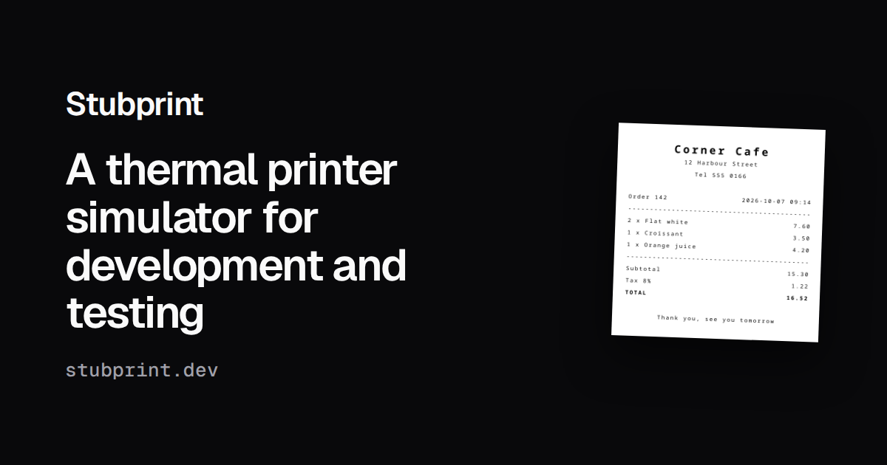

<p align="center">
  <a href="https://stubprint.dev">
    
  </a>
</p>

# Stubprint

A thermal printer simulator for development and testing, at [stubprint.dev](https://stubprint.dev).
It reads ESC/POS, Star Line and StarPRNT like the printers do, and shows what would have come out.

## Install

```bash
# macOS and Linux
curl -fsSL https://stubprint.dev/install.sh | sh
```

```powershell
# Windows, in PowerShell
irm https://stubprint.dev/install.ps1 | iex
```

For a version, put it in the address: `https://stubprint.dev/<version>/install.sh`.

## Use

```bash
stubprint                      # the web app is at http://127.0.0.1:8080, the printer on :9100
stubprint print --sample cafe  # in another terminal
```

More in [docs](docs/README.md). To work on it, see [CONTRIBUTING.md](CONTRIBUTING.md): `docker compose up -d`
starts the server and the web app.

## Licence

MIT, see [LICENSE](LICENSE) and [THIRD-PARTY.md](THIRD-PARTY.md). Epson, ESC/POS and Star are
trademarks of their owners, and this project is not affiliated with them.
